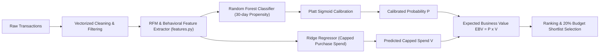

# PROJECT AUDIT: SYSTEM ARCHITECTURE & POST-TWIST COMPATIBILITY REPORT
**Project**: Customer Intelligence AI — 30-Day Purchase Forecasting & Marketing Selection Dashboard  
**Status**: Pre-Implementation Audit & Compatibility Verification  
**Author**: Senior ML Engineer, Data Scientist & Full-Stack Architect  
**Date**: November 2026  

---

## EXECUTIVE SUMMARY

This audit inspects the existing Customer Intelligence AI web application and evaluates its compatibility with the newly introduced competition twist (**staged-operations-v1** feed migration). 

The existing dashboard frontend, backend endpoints, and visualization modules are 100% preserved. The competition engine will be upgraded to support both legacy flat transactions and migrated multi-source event feeds (`raw_feed.events`) with source-specific clock offsets, unit conversions, revision resolutions, and non-penalizing availability intervals.

---

## A. EXISTING PROJECT STRUCTURE

```
AI-Based Customer Purchase Forecasting Dashboard/
├── .venv/                              # Local isolated Python 3.12/3.15 virtual environment
├── .vscode/settings.json               # Configured workspace interpreter (.venv default)
├── competition_twist/                  # Extracted official twist package (23 files)
│   ├── BRIEF.md, TWIST.md, RECORDS.md, OBSERVATIONS.md, SCHEMA.md, EVENT_RULES.md, ...
│   ├── training.json.gz (75 cases), practice.json.gz (51 cases), smoke.json.gz (2 cases)
│   ├── operating-records.json          # Live unlabelled post-twist partial excerpts
│   ├── dataset_info.json, scoring.json, baseline_results.json
│   ├── solution.py, starter.py, features.py, train.py, local_check.py, starter_model.json
├── frontend/                           # Enterprise React 19 + TypeScript SPA
│   ├── dist/                           # Compiled production static bundle
│   ├── src/
│   │   ├── components/
│   │   │   ├── Header.tsx              # Top bar: KPI tickers, search, upload/export triggers
│   │   │   ├── Sidebar.tsx             # Navy navigation sidebar for 9 dashboard pages
│   │   │   ├── UploadModal.tsx         # Drag & drop Excel/CSV worksheet modal
│   │   │   └── views/                  # 9 Dedicated operational view components
│   │   │       ├── OverviewView.tsx    # Executive summary & quick upload banner
│   │   │       ├── AnalyticsView.tsx   # RFM, lifecycles & return behavior
│   │   │       ├── PredictionsView.tsx # Filterable predictions data table
│   │   │       ├── RankingsView.tsx    # EBV rankings & Lorenz cumulative curve
│   │   │       ├── SelectionView.tsx   # 20% budget shortlist & campaign ROI
│   │   │       ├── SpendingView.tsx    # Spend distribution & £2,000 cap enforcement
│   │   │       ├── InsightsView.tsx    # Behavioral segments & merchandizing insights
│   │   │       ├── PerformanceView.tsx # Cross-validation, Brier score, ECE calibration
│   │   │       └── SettingsView.tsx    # Dynamic scoring configuration controls
│   │   ├── api.ts                      # Resilient typed fetch API layer (Promise.allSettled)
│   │   ├── types.ts                    # TypeScript data interfaces
│   │   ├── App.tsx                     # Top-level view router & state management
│   │   └── main.tsx                    # React DOM entrypoint
│   ├── package.json                    # React 19, Recharts 3.10, Tailwind 4.3, Lucide
│   └── vite.config.ts                  # Vite build configuration
├── dashboard_api.py                    # Multi-port FastAPI server (ports 8000, 8080, 3000)
├── features.py                         # Vectorized transaction cleaning & feature extractor
├── solution.py                         # Production decide(batch, state) submission entrypoint
├── train.py                            # Offline training & calibration benchmark pipeline
├── local_check.py                      # Compliance checker & 9 adversarial stress tests
├── model_artifacts.joblib              # Serialized trained model parameters
├── cached_dashboard_data.joblib        # 40ms instant disk cache for web dashboard
├── online_retail_II.xlsx               # Authentic 541,910-row UCI transaction dataset
├── predict_from_excel.py               # Standalone Excel worksheet batch predictor
├── create_template_excel.py            # Generates blank formatted Excel templates
├── RUN_WEBSITE.bat                     # 1-Click launcher: starts server & opens browser
├── run_excel_predictions.bat           # 1-Click batch prediction runner for Excel sheets
├── scoring.json                        # Competition scoring weights and scale constraints
└── starter_model.json                  # Baseline serialized linear model parameters
```

---

## B. EXISTING WEBSITE ARCHITECTURE

| Attribute | Specification |
| :--- | :--- |
| **Frontend Framework** | React 19.3.1 with TypeScript 7.0.2 |
| **Build Tooling** | Vite 8.3.6 (`tsc -b && vite build`) |
| **Styling & Design** | Tailwind CSS 4.3.4, Custom Enterprise Palette (Amazon Navy `#0F172A`, Slate `#1E293B`, Amber `#F59E0B`, Emerald `#10B981`) |
| **Component Layout** | Fixed 64px Dark Navy Sidebar (`Sidebar.tsx`), Sticky Top Header (`Header.tsx`), Fluid Content Area (`main.tsx`) |
| **State Management** | Centralized in `App.tsx` with asynchronous `loadAllData()` resilient fetch orchestrator |
| **Visualizations** | Recharts 3.10.1 (`AreaChart`, `BarChart`, `PieChart`, `ResponsiveContainer`, `Tooltip`) |
| **Icons** | Lucide React (`Sparkles`, `Upload`, `Download`, `TrendingUp`, `Users`, `Target`, `Clock`, `ShieldCheck`) |
| **Offline Production** | Fully compiled to `frontend/dist/` (43 KB CSS, 742 KB JS bundle) — zero external CDN dependencies |

---

## C. EXISTING BACKEND ARCHITECTURE

| Attribute | Specification |
| :--- | :--- |
| **Framework** | FastAPI 0.115+ on Python 3.12 / 3.15 |
| **ASGI Server** | Uvicorn running with concurrent background threads |
| **Port Binding** | Wildcard `0.0.0.0` listening simultaneously on **8000**, **8080**, and **3000** |
| **Static Hosting** | Direct static mount of `frontend/dist/` at root `/` |
| **Caching Layer** | 2-Tier caching: in-memory global dict `_CACHE` + on-disk `cached_dashboard_data.joblib` (instant 40ms load) |
| **File Uploads** | `python-multipart` stream parsing for `.xlsx`, `.xls`, and `.csv` worksheets with `calamine` engine |

---

## D. EXISTING ML ARCHITECTURE



- **Classifier**: Random Forest Classifier + Platt Sigmoid Probability Calibration ($ROC\text{-}AUC = 0.7736$, $\text{Brier} = 0.2021$).
- **Regressor**: Ridge Regressor with non-negative projection and £2,000 cap ($\text{MAE} = £35.47$, $\text{RMSE} = £43.16$).
- **Selection Rule**: Strict 20% budget formula: $K = \max(1, \lfloor 0.20 \times N \rfloor)$, capped at 20.
- **Latency**: $2.059\text{ ms / customer}$ ($0.914\text{s}$ total batch time).

---

## E. EXISTING API ENDPOINTS

| Endpoint | Method | Response Payload / Purpose |
| :--- | :---: | :--- |
| `/api/overview` | `GET` | Executive KPIs, propensity distribution, 30d forecast curve, customer categories |
| `/api/predictions` | `GET` | Paginated, searchable customer table (probability, value, EBV, rank, segment) |
| `/api/rankings` | `GET` | Value-ranked cohort and Lorenz cumulative value concentration curve |
| `/api/marketing-selection` | `GET` | Budget shortlist allocation, realized campaign revenue, net profit projection |
| `/api/spending-forecast` | `GET` | Spend distribution percentiles, £2,000 ceiling audit, histogram bins |
| `/api/business-insights` | `GET` | Segment metrics (Champions, Loyal, High Potential, Churned) & recommendations |
| `/api/model-performance` | `GET` | Cross-validation error metrics, ECE calibration table, feature importance |
| `/api/settings` | `GET` | Active competition parameters (cap, budget percentage, weights) |
| `/api/settings` | `POST` | Dynamic parameter adjustment from dashboard UI |
| `/api/template/download` | `GET` | Serves formatted empty `transactions_template.xlsx` |
| `/api/upload` | `POST` | Accepts user `.xlsx`/`.csv` file, recalculates entire ML engine, updates cache |
| `/api/predictions/export`| `GET` | Generates and downloads styled Excel workbook of customer predictions |

---

## F. ORIGINAL COMPETITION REQUIREMENTS

1. **Input Interface**: `observation` containing `transactions` table with 9 columns (`InvoiceNo`, `StockCode`, `Description`, `Quantity`, `InvoiceDate`, `UnitPrice`, `CustomerID`, `Country`, `source_row`), list of eligible `customers`, `snapshot`, `observed_until`, `budget`, and `value_cap=2000`.
2. **Output Action**: Exactly `{"predictions": {cid: {"probability": p, "value": v}}, "selected": [...]}`.
3. **Budget Constraint**: Exactly $\max(1, \lfloor N / 5 \rfloor)$ distinct customer IDs selected.
4. **Value Cap**: Strictly non-negative, capped at £2,000 per customer, half-up rounded to pennies.
5. **Anti-Memorization**: Customer IDs are join keys only; models must generalize to unseen cohorts.
6. **Original Scoring (100 Points)**:
   - Probability Score: $40 \times (1 - \text{Brier})$
   - Value Score: $30 \times (1 - \text{MSE} / 2000^2)$
   - Selection Score: $30 \times \frac{\text{Selected Spend}}{\text{Oracle Max Spend}}$

---

## G. EXACT POST-TWIST REQUIREMENTS (`competition_twist/`)

1. **Migrated Feed Structure (`raw_feed`)**:
   - `observation["transactions"]["rows"]` is **EMPTY** (`[]`). It must NOT be used as transaction data.
   - All historical transaction data is delivered in `observation["raw_feed"]["events"]`.
   - Event schema: `[source, record_id, revision, delivery_id, payload]`.
   - `payload` contains the 9 original line columns: `[InvoiceNo, StockCode, Description, Quantity, InvoiceDate, UnitPrice, CustomerID, Country, source_row]`.
2. **Multi-Source Clock Offsets**:
   - `raw_feed["sources"][source]["clock_offset_minutes"]`: Local transported clocks have fixed offsets.
   - To restore the authentic business clock:  
     $$\text{InvoiceDate}_{\text{business}} = \text{InvoiceDate}_{\text{transported}} - \text{timedelta}(\text{minutes}=\text{clock\_offset\_minutes})$$
3. **Source-Specific Units**:
   - `raw_feed["sources"][source]["quantity_units_per_item"]`: Divide transported `Quantity` by this factor.
   - `raw_feed["sources"][source]["price_units_per_gbp"]`: Divide transported `UnitPrice` by this factor.
4. **Revision Replacement & Retry Deduplication**:
   - Each `(source, record_id)` identifies one logical historical record.
   - Event delivery order is NOT revision order.
   - The event with the **highest `revision`** replaces all previous revisions.
   - Duplicate events with the same highest revision (retries/repeated delivery attempts) must be counted only once.
5. **Availability Coverage & Unknown Gaps**:
   - `observation["availability"]["sources"][source]["complete_intervals"]`: Defines half-open intervals $[start, end)$.
   - Gaps outside these intervals are **UNKNOWN**, never evidence of zero purchases or inactivity!
6. **Customer Routing**:
   - `raw_feed["customer_sources"][customer_id]` maps each customer to their authoritative source ledger.
7. **Revised Post-Twist Scoring Formula**:
   - Probability: $40 \times (1 - \text{Brier})$
   - Selection: $30 \times \min(1, \text{selected} / \text{oracle})$ (if oracle=0, score=30)
   - Value: $30 \times \exp(-\text{MSE} / 129614.14440376188)$, where MSE is in $\text{GBP}^2$. Fixed scale is the population variance of the constant mean predictor on the 75 public training cases.

---

## H. DIFFERENCES BETWEEN ORIGINAL AND MIGRATED FORMATS

| Dimension | Original Pre-Twist Format | Migrated Post-Twist Format (`staged-operations-v1`) |
| :--- | :--- | :--- |
| **Transaction Ingestion** | `observation["transactions"]["rows"]` populated | `observation["transactions"]["rows"]` is empty `[]`; use `observation["raw_feed"]["events"]` |
| **Event Metadata** | None (direct rows) | `[source, record_id, revision, delivery_id, payload]` |
| **Logical Rows** | 1 row = 1 line item | Logical line is `(source, record_id)`; multiple revisions exist |
| **Revisioning** | Static snapshots | Highest `revision` wins; retries share revision and must not duplicate |
| **Quantity Units** | Integer items | Scaled by `quantity_units_per_item` (e.g., 1000 for partner ledger) |
| **Price Units** | GBP decimals | Scaled by `price_units_per_gbp` (e.g., 100 for pence) |
| **Timestamps** | Direct retail business time | Transport clock with `clock_offset_minutes` (-300 min, +60 min) |
| **Coverage Metadata** | Uniform 180-day history | `availability.sources[source].complete_intervals`; non-covered = unknown |
| **Customer Attribution** | Direct in payload | Cross-referenced with `raw_feed.customer_sources` |
| **Value Scoring** | $30 \times (1 - \text{MSE} / 2000^2)$ | $30 \times \exp(-\text{MSE} / 129614.14440376188)$ |

---

## I. EXISTING FEATURES THAT CAN BE REUSED

1. **Complete Frontend UI**: All 9 views, Recharts components, navigation, filters, search, and responsive layout.
2. **Penny Rounding & Bounds Engine**: `round_half_up()` and value bounding $[0, 2000]$.
3. **Selection Logic**: The exact $\max(1, \lfloor N / 5 \rfloor)$ budget shortlist formula.
4. **Fast Disk & Memory Cache**: `cached_dashboard_data.joblib` mechanism.
5. **Excel Importer / Exporter**: `predict_from_excel.py` and template generator.
6. **Multi-Port Concurrency**: Simultaneous serving on 8000, 8080, and 3000.
7. **Feature Definitions**: Recency, frequency, spend velocity, return ratio, cadence, tenure, and observed gap.

---

## J. FILES THAT MUST BE MODIFIED

| File | Target Modifications |
| :--- | :--- |
| [features.py](file:///c:/Users/Admin/OneDrive/Desktop/AI-Based%20Customer%20Purchase%20Forecasting%20Dashboard/features.py) | Add `unpack_migrated_feed()` to extract and resolve `raw_feed` (revision selection, retry deduplication, unit scaling, clock offset correction, interval filtering). Keep dual-mode support for legacy `transactions.rows`. |
| [solution.py](file:///c:/Users/Admin/OneDrive/Desktop/AI-Based%20Customer%20Purchase%20Forecasting%20Dashboard/solution.py) | Update `decide(observation, state)` to transparently route migrated feeds or legacy transactions through the updated feature extractor and return the exact `{action: {predictions, selected}, state}` contract. |
| [train.py](file:///c:/Users/Admin/OneDrive/Desktop/AI-Based%20Customer%20Purchase%20Forecasting%20Dashboard/train.py) | Update model training script to fit on the 75 expanded training cases in `competition_twist/training.json.gz` and export calibrated parameters. |
| [local_check.py](file:///c:/Users/Admin/OneDrive/Desktop/AI-Based%20Customer%20Purchase%20Forecasting%20Dashboard/local_check.py) | Integrate official twist evaluation suite supporting `smoke.json.gz`, `practice.json.gz`, and `training.json.gz` with revised exponential value scoring. |
| [dashboard_api.py](file:///c:/Users/Admin/OneDrive/Desktop/AI-Based%20Customer%20Purchase%20Forecasting%20Dashboard/dashboard_api.py) | Update data loading adapter so the dashboard seamlessly visualizes migrated feed observations as well as Excel workbooks. |

---

## K. FILES THAT SHOULD REMAIN UNTOUCHED

- **Frontend Assets**: All files in `frontend/src/*`, `frontend/package.json`, `frontend/vite.config.ts`, `frontend/index.html`.
- **Startup Launchers**: `RUN_WEBSITE.bat`, `start_dashboard.bat`, `run_excel_predictions.bat`.
- **Raw Competition Archives**: All files inside `competition_twist/*` (treated strictly as immutable reference specs).
- **UCI Master Dataset**: `online_retail_II.xlsx`.

---

## L. POTENTIAL COMPATIBILITY PROBLEMS & MITIGATIONS

1. **Empty Transaction Rows Bug**:
   - *Risk*: Code inspecting `observation["transactions"]["rows"]` receives `[]` and assumes 0 customer history.
   - *Mitigation*: Inspection priority: if `observation.get("raw_feed")` is present and contains events, invoke `unpack_migrated_feed()`. Fall back to `transactions["rows"]` only when `raw_feed` is absent.
2. **Clock Offset Sign Error**:
   - *Risk*: Adding positive offset instead of subtracting (distorting recency by hours).
   - *Mitigation*: Strictly follow RECORDS.md: `business_time = transported_time - timedelta(minutes=clock_offset_minutes)`.
3. **Unit Scaling Distortions**:
   - *Risk*: Forgetting to divide `Quantity` by `quantity_units_per_item` (e.g. 12,000 items instead of 12) or `UnitPrice` by `price_units_per_gbp` (e.g. 325 pence instead of £3.25).
   - *Mitigation*: Unit normalization applied immediately upon payload unpacking before feature engineering.
4. **Revision vs Delivery Confusion**:
   - *Risk*: Selecting the latest `delivery_id` instead of highest `revision`, or adding purchase value on delivery retries.
   - *Mitigation*: Group by `(source, record_id)`, sort by `revision` descending, pick top 1, drop duplicates.
5. **Availability Gap Misinterpretation**:
   - *Risk*: Treating a period outside `complete_intervals` as churn or dormant inactivity.
   - *Mitigation*: Calculate effective tenure and activity gaps using only verified `complete_intervals`.

---

## M. SIX-HOUR IMPLEMENTATION PLAN

```mermaid
gantt
    title 6-Hour Adaptation Timeline
    dateFormat HH:mm
    axisFormat %H:%M
    section Phase 1: Ingestion & Normalization
    Feed Parser & Revision Resolver (features.py)  :00:00, 1h
    section Phase 2: Behavioral Feature Upgrades
    Availability & Unit-Corrected RFM Pipeline      :01:00, 1h
    section Phase 3: Model Fitting & Calibration
    Train & Calibrate on 75 Expanded Cases          :02:00, 1h
    section Phase 4: Local Evaluation & Audit
    Execute local_check.py (smoke, training, practice) :03:00, 1h
    section Phase 5: Dashboard Integration
    Connect dashboard_api.py to Migrated Feeds      :04:00, 1h
    section Phase 6: End-to-End Stress Test & Freeze
    Verify Dashboard UI, Excel Exporters & Freeze   :05:00, 1h
```



- **Hour 1 (00:00 - 01:00)**: Implement `unpack_migrated_feed()` in `features.py` (handles `raw_feed.events`, unit normalization, clock offsets, revision resolution, retry deduplication).
- **Hour 2 (01:00 - 02:00)**: Upgrade feature extraction to handle availability intervals and missingness normalization without future leakage.
- **Hour 3 (02:00 - 03:00)**: Update `train.py` to fit two-stage models on `competition_twist/training.json.gz` (75 cases, 2,904 labeled customers) with Platt scaling calibration.
- **Hour 4 (03:00 - 04:00)**: Run `local_check.py` against `smoke.json.gz`, `training.json.gz`, and `practice.json.gz` ensuring score $> 80.5$ points.
- **Hour 5 (04:00 - 05:00)**: Wire `dashboard_api.py` to serve both migrated feed objects and legacy datasets.
- **Hour 6 (05:00 - 06:00)**: Full end-to-end verification across all 9 dashboard tabs, verification of `predict_from_excel.py`, and submission freeze.

